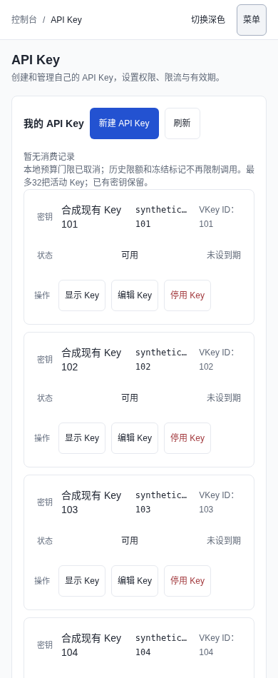
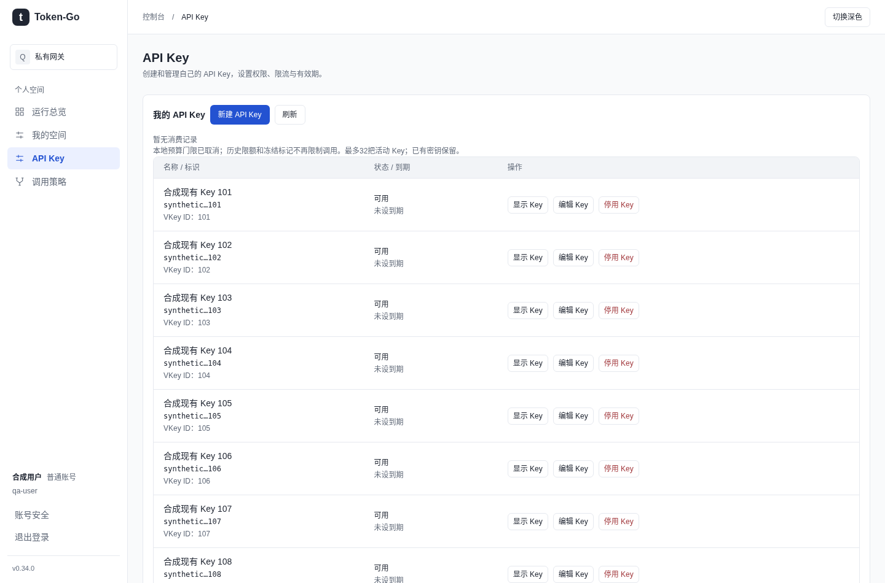

# 普通用户 API Key 独立入口恢复

2026-11-14，已上线。Web 源码 `12cd8166da36cccc086f68b0250c410b9dc21a8c`，运行时和 CLI 使用已公开验收的 qiwolf.32/source `4ab9085fcb758038d3a02c6de031dec4e659b612` 原二进制；这是正式 .32 发布后的 Web 修复，不移动 .32 标签、不替换其公开附件。

## 原因和结果

旧“我的空间”把 Key 管理放在长图表及调用明细之后，并依赖门户用量请求成功才挂载，普通用户导航没有直接入口。

现在普通用户左侧菜单有 **API Key**，手机在“菜单”中进入；“我的空间”页头也有同名直达按钮。直接地址为 `/ui/#keys`，支持刷新及前进后退。页面复用原本人 Key 管理器，独立读取 `/api/account/keys`，用量和统计失败不影响进入。管理员仍使用“用户与 Key”，个人入口不扩大管理权限。

新导航测试发现旧 Key 列表、统计响应在离页后读取已销毁状态会触发 WASM panic。已复用现有 `PageTasks` 页面任务取消机制，离页后停止回调，原页内 owner/generation 检查保持。没有更改 Key API、调用策略、模型选源或本地金额规则。

## 验证与上线

Mac 编辑，build-test 同步全部最新源码并核对 SHA256。Web 库 **226 项通过**，WASM release 构建通过；Chromium/WebKit ×390/1440 ×普通用户/管理员 **8 场景、68 项检查通过**，无 pageerror/fixtureerror。验证菜单、页头入口、长页滚动后可见、直达刷新/历史、统计500隔离、完整合成 Key 创建/显示/编辑/停用/恢复/撤销/删除及角色边界。另有 Key 列表、统计、授权元数据延迟响应的 **3 个回归通过**。首轮编译错误、panic 复现及修复前后日志保留，不当作已通过。

线上原服务端尚无 .32 的独立统计 API，因此将已验证的官方 .32 server/CLI 与新 Web 一起切换，schema47→47。关闭入口、排空在途、停服一致备份后更新；失败策略只回退代码，绝不恢复旧业务库。已确认配置/凭据身份、原数据库 inode、schema47 和计价/路由/用户授权保持，旧 hashed Web 资源保留，导出 timer 恢复原状态。维护时间与摘要见[机器可读收据](evidence/verification.json)。

公网 HTML、JS、WASM 和 CSS 共 **8 个关键资源**与 build-test 字节一致，readyz 正常。未使用生产用户新建、修改或删除真实 Key，也未显示真实 Key 明文；角色及 CRUD 行为属于严格合成 API 的真实 WASM 验证，不冒充真实用户生产操作。没有实体 iPhone 验收。

刷新旧页面后进入“API Key”即可使用。完整原始日志、产物和私用部署备份引用留在本地项目 `review/personal-key-entry-20261114/`，未将凭据、业务库或运维原件纳入 Git。

