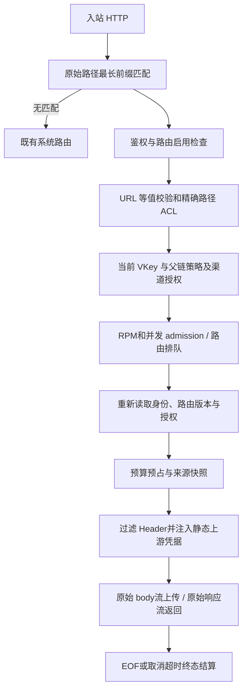
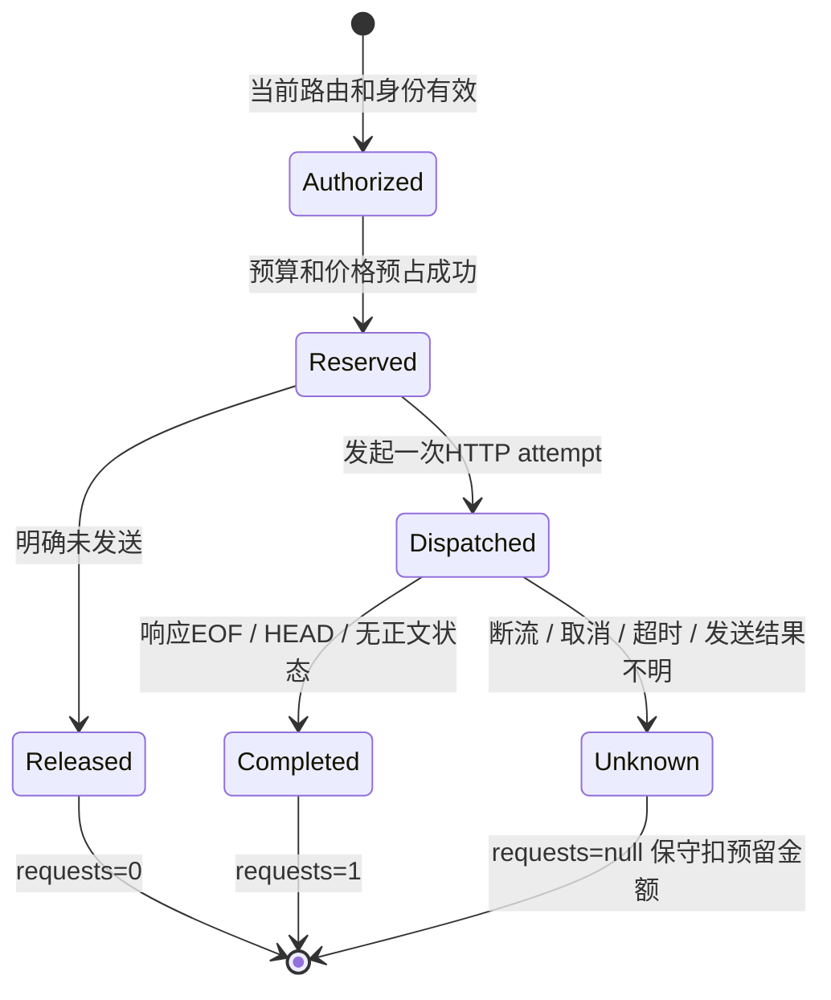

# 通用 HTTP 透传开发与 MinerU 同步接入

本文是实现合同和交付检查表。面板操作见[通用 HTTP 透传](passthrough.md)，设计与执行记录见[设计](superpowers/specs/2026-10-21-passthrough-design.md)和[计划](superpowers/plans/2026-10-21-passthrough.md)。

交付状态（2026-10-21）：[v0.34.0-qiwolf.6](https://github.com/qiwolf/tokengo/releases/tag/v0.34.0-qiwolf.6) 已公开，源码提交 `d5660992a6a1ef0b320ff143a19404ac3abad23e`。237 已完成 schema 38→39 部署迁移；Face/CLIP 合成业务响应均 HTTP 200，且与直连正文逐字节一致；MinerU 合成 PDF 同步解析返回 completed，内联 Markdown 包含预置标记。现有调用方未切流，验收临时路由、VKey、用户及网关会话已清理，未留下永久业务路由。MinerU 原生异步链仍不支持。

该提交 GitHub CI 为 998 项 Rust 通过、0 失败、2 忽略，13 项 Python 通过，WASM 检查通过。公开9项资产校验、原生包匿名下载和GHCR匿名拉取已通过；发布产物的原生包和镜像隔离运行亦通过，范围为macOS Docker中的Linux AMD64仿真环境，未访问生产服务。原生CLI/服务端/WASM、root透传CRUD与密钥掩码/内部渠道隐藏、ops禁止新透传管理及既有90项能力清单、令牌签发/身份/撤销回归已核验；镜像非root/只读文件系统、ready、重启和同卷重建持久化已核验。本文件区分真实解析、字节传输、构建及分发证据，不以健康 200 替代业务验收。

用户已授权按“必要验证 → 237 部署与真实调用 → 验收通过 → GitHub 推送及原生包/容器发布”的顺序交付；无须重复批准设计。任一验收失败须修复或报告阻断，不得跳过 237 真实调用先发布。本文不记录现场私有 IP、SSH 入口、账号密码、真实 VKey、静态 Header 或历史文档内容；现场证据单独保存在不随仓库发布的运维记录中。

## 1. 第一阶段范围

透传是独立 HTTP 路由，不注册为 OpenAI 模型，不使用 LLM 请求体转换器。SQLite 是唯一配置源，不新增 YAML 或 MinerU 专用数据库表。

MinerU 第一阶段仅接同步兼容 HTTP 服务（默认端口 5024）的 `/file_parse` 和 `/health`：

| 项目 | 合同 |
| --- | --- |
| 网关前缀 | `/mineru/`，`strip_prefix=true` |
| 上游示例 | `http://mineru-upstream.example:5024`，部署时替换为已核实地址 |
| 精确路径 | `allowed_paths=["/file_parse","/health"]`，不开放整个 `/v1/` |
| 客户端 | `POST /mineru/file_parse` 上传 multipart 字段 `files`；`GET /mineru/health` 同样使用专用 VKey |
| 返回 | 同步 JSON 中的内联 Markdown，或上游返回的 ZIP 字节；不改业务字段 |
| 凭据 | 客户端只带 Tokengo VKey；如上游今后要求固定 Bearer，通过加密的服务端 Header 注入 |
| 现有客户端 | 不自动修改 `doc-extract` 默认路由；另行接入时健康 GET 和上传 POST 必须同时加 VKey |

不实现原生异步 tasks/uploads/files/jobs 全链、动态 ID 路径 ACL、正文或 Location URL 重写、跨服务账户资源授权、后台任务取消及按文档聚合收费。原生 API 的绝对上传 URL、根相对任务链接和动态 ID 路径需要独立设计；`allowed_paths=null` 不能当成这套设计的替代。透传不会让兼容服务未支持的高级选项变为可用。

## 2. 模块与数据模型

| 文件 | 职责 |
| --- | --- |
| `crates/server/src/passthrough.rs` | 外层分发、原始 HTTP URL/Header/字节转发、admission、预占和终态 Guard |
| `crates/server/src/db/passthrough.rs` | 配置验证、事务 CRUD、版本检查、前缀匹配、凭据解密和授权 |
| `crates/server/src/db/passthrough.sql` | schema 39 的表与渠道类型 |
| `crates/server/src/routes/passthrough_admin.rs` | root 配置 API |
| `crates/server/src/routes/passthrough_probe.rs` | root 手动 HTTP 诊断和系统诊断结算 |
| `crates/web/src/pages/passthrough.rs` | 渠道页透传面板、配置与诊断表单 |
| `crates/server/tests/passthrough*.rs` | 管理、数据面、真实 loopback HTTP 回归 |

`channels.transport_kind` 新增 `llm` / `passthrough`；旧渠道默认 `llm`。每条透传路由有稳定内部 `channel_id`，用于既有授权、并发和按次金融账，不参与 LLM 模型发现、provider 回填或普通渠道管理。

`passthrough_routes` 保存 `id`、`channel_id`、`revision`、名称、唯一前缀、固定 upstream、剥离开关、启停、`price_id`、超时、并发、body 限额及路径 ACL JSON。`passthrough_headers` 按 `(route_id,name)` 保存随机 nonce 与 AES-GCM 密文；使用既有实例主密钥，读取仅投影 `{name,has_value}`，无明文 reveal API。`passthrough_acl` 保存授权 Key ID。

创建在同一事务建立内部渠道、路由、请求价格版本、ACL、加密 Header 和审计。更新要求读取所得 `revision`，成功递增；改价追加不可变价格版本，不改旧账快照。删除要求版本一致，移除路由、Header、ACL 及内部渠道，保留请求和金融历史；不能把删除再创建当作保留身份的改名方式。

## 3. 管理 API 与配置约束

当前仅 root 管理凭据可用；浏览器使用现有 HttpOnly Cookie、同源检查和写入 CSRF 头。管理员 VKey、普通用户和独立运维令牌均不能管理或诊断透传路由。新增路由不会自动出现在 ops 动作登记中。

| 方法与路径 | 行为 |
| --- | --- |
| `GET /api/passthrough-routes` | 返回路由数组与 Header 安全摘要 |
| `POST /api/passthrough-routes` | 创建并返回完整安全路由对象 |
| `PUT /api/passthrough-routes/{id}` | 完整替换配置，必须提供 `revision`；冲突 409 |
| `DELETE /api/passthrough-routes/{id}?revision=N` | 按版本删除；冲突 409 |
| `POST /api/passthrough-routes/{id}/probe` | 手动无正文诊断，返回 `healthy/http_status/latency_ms/inference_verified:false` |

MinerU 初始配置示例（ID 和域名均为占位值，创建时保持停用）：

```json
{
  "name": "MinerU synchronous",
  "prefix": "/mineru/",
  "upstream": "http://mineru-upstream.example:5024",
  "strip_prefix": true,
  "enabled": false,
  "price_micro_usd_per_request": 0,
  "timeout_secs": 1000,
  "max_concurrent": 1,
  "max_body_bytes": 20971520,
  "allowed_key_ids": [101],
  "allowed_paths": ["/file_parse", "/health"],
  "headers": []
}
```

`101` 必须换成专用活动 VKey 的真实数字 ID，不能填写密钥明文。`enabled` 默认 false，Key 白名单默认空集合，均不会自动开放调用。API 的 `allowed_paths` 缺省/null 表示所有子路径，`[]` 表示全部拒绝；面板新建默认选 `[]`。MinerU 必须显式提供上述两条路径，不能依赖 API 缺省值。路径是**最终上游精确路径**，不是模板，不含 query，不按 HTTP 方法区分；若 upstream 含路径前缀，ACL 也须包含该前缀。

配置范围：总超时 1–3600 秒（默认 60）、并发 1–1024（默认 16）、body 1 字节至 100 MiB（默认 20 MiB）、非负整数 microUSD/次、最多 64 个静态 Header 和 256 个 Key ID / 路径。MinerU 建议并发 1–2；兼容层等待可能达 900 秒，网关 1000 秒示例为上传/排队/返回预留余量，调用方和反向代理亦须匹配，不能仅修改网关。body 上限包含 multipart 开销，不等于裸文件限额，后端允许较大文件不代表网关允许。

Header 写入 `{name,value}`；`value:null` 保留同名现存密文，新 Header 必须提供值；列表中移除整项表示删除。Header 名称不能重复或使用 Host、Content-Length、Connection 等保留传输字段。编辑结束清除表单内尚未保存的明文；读取、错误、审计不打印它们。

## 4. 路由、身份和原始传输流程



最长前缀先选中再鉴权；较长路由停用、无授权或路径被拒绝时不能回落到较短路由。保留 `/api/`、`/v1/`、`/ui/`、健康检查、认证等系统命名空间。

客户端使用 `Authorization: Bearer <VKey>`、`x-api-key` 或透传专用 `api-key`，冲突或重复认证字段被拒绝；管理会话、ops token 不能充当数据面 VKey。路由白名单显式绑定 Key ID，同时现有有效父链及用户/Key策略实时生效；它不能扩大 `allowed_channels` 或 `allow_paid`。`allowed_models=[]` 可用于阻止专用 Key 调用 LLM；透传本身不要求开放伪造模型名。受限 `allowed_channels` 须包含只读的内部计费接入 ID；收费路由还须允许付费。白名单授权覆盖该Key本身与其有效后代，撤销父Key会阻止后代调用；本轮保留该继承语义，路径仍按精确字符串匹配。

不解析 JSON、multipart、SSE、PDF、ZIP；不重试、不跟随重定向、不自动压缩/解压、不继承代理环境。保留业务正文和 query 字节，以及重复 end-to-end 响应 Header。两侧过滤 hop-by-hop 和 Connection 指名字段；入站 Host、Authorization、x-api-key、api-key、Cookie 不转给上游，随后注入路由静态 Header。Host 与 HTTP framing 由客户端重新生成，因此不承诺 TCP 分块边界或 HTTP framing 逐字节相同。

普通 HTTP 方法可转发；CONNECT、Upgrade/WebSocket 被拒绝。URL 只允许 HTTP(S)，配置中禁止 userinfo/query/fragment、空白、反斜杠和点路径。请求经 HTTP 客户端解析后若 path/query/origin 与预期不同，返回 400，不能悄悄规范化后转发。固定 upstream 及 root 配置边界不等于后端网络封禁；应另行管理直连服务的网络暴露。

## 5. admission、计量与状态机

用户、本 Key 和全部祖先 RPM/并发继续生效。opaque HTTP 无法可靠统计 token，任一层存在 TPM 限额均拒绝，而非假报零。路由并发与身份 admission guard 保持至响应终态；排队后重查路由 ID/revision、启用、Key、父链和策略，防止用旧授权或旧凭据发送。总期限覆盖路由排队、上传及响应读取；独立有界 pump 在下游停止读取时仍执行期限，避免永久占用并发。



每次 HTTP attempt 按路由当前价格预占，4xx/5xx 完整返回亦记 1 次；不把错误正文解析成 LLM 错误类型。明确连接建立前失败可记 0 次；已发出后不完整保持未知。token 在账本中保持 null，诊断表的数值占位必须结合 known 标志解释。沿用持久 billing outbox、终态幂等和启动恢复；结算失败保留待重放记录，不靠客户端断开规避费用。

**数据面健康 GET 也受 VKey 鉴权、RPM/并发和该路由价格约束**，与 `/file_parse` 在同一路由即按同一单价计数，不存在自动健康免费例外。若业务要求健康免费，应另行决定独立路由与客户端地址，不在本轮悄悄拆分。

root probe 例外：只允许 GET/POST/HEAD、明确路径及预期状态 200–599，无请求 body；路径须已获路由授权，路由必须启用，排队后重查 revision。使用路由静态 Header 和共享并发，最长 60 秒、响应最多读取 128 KiB，读取后丢弃正文。写“系统诊断”账、用户/Key 为系统身份、不扣用户预算；这不表示供应商执行本身免费。手动 probe 不属于定时探针调度，也不能验证真实文档解析。

MinerU 网关超时或客户端取消不证明后端作业取消；不要自动重试完整上传。服务可能已开始处理，重试会重复任务及费用。

## 6. MinerU 同步客户端接入

可选客户端默认上传超时1050秒、整个multipart不超过20MiB、响应不超过64MiB，均可显式调整；标准库超时是socket操作超时，全链绝对期限由网关保证。它拒绝跳转和环境代理，凭据文件须本人所有、常规文件且无组/其他用户权限；错误不输出上游正文或凭据。

先创建专用 VKey 与小额/零价验收路由，核对 ACL 后按 revision 启用。使用新建的合成单页 PDF，不上传业务档案或历史材料。以下只示意协议，域名、文件和环境变量须由部署者提供；不要把真实 token 写进脚本、命令历史或仓库：

```sh
# key文件由部署者预先安全创建并设为0600，命令中只有路径，不包含密钥值。
TOKENGO_API_KEY_FILE=/private/path/mineru.vkey \
python3 scripts/mineru-gateway-client.py \
  --url https://gateway.example/mineru/file_parse \
  --file synthetic-one-page.pdf --output result.md --timeout 1050
# ZIP原样输出：增加 --format zip --output result.zip。
# Linux原生分发包中，把 scripts/ 替换为 tools/；无需安装第三方Python包。
```

新客户端负责生成匹配正文的multipart boundary。显式非completed状态被拒绝；为兼容同步旧接口，缺省status但包含有效内联Markdown的响应可接受。实际237验收另外检查上游completed和预置识别标记。

本轮已为本机 `doc-extract` 的健康GET和上传POST补充可选的 `MINERU_API_KEY` / `MINERU_API_KEY_FILE`（二选一）。不设置这些专属变量时，仍按原默认URL匿名直连并保留原有本地回退；不会继承其他LLM用途的 `TOKENGO_API_KEY`。实际接入时须同时配置 `MINERU_URL` 与专属凭据，并确认返回method为mineru-gpu，而非只看CLI退出成功。两处请求禁跳转与环境代理，错误不输出上游正文或密钥。独立示例客户端的文件/响应限额不代表原doc-extract已改为流式或增加相同大小限额。其他MCP/命令行入口没有因此迁移。

## 7. 测试矩阵与证据状态

| 检查 | 当前证据 / 必要补验 |
| --- | --- |
| 数据库迁移、Header 加密/保留/删除、revision、内部渠道隐藏 | 已有 Rust 单元/管理测试；变更后针对性重跑 |
| 匿名/普通账号/管理员VKey/ops不能管理 | `passthrough_admin.rs` 已有隔离回归 |
| 二进制/multipart/query、只转服务端凭据 | `passthrough.rs` 已有集成回归 |
| 最长拒绝不回落、路径ACL、预算/TPM/RPM/body限额 | 已有回归；本轮保留Key与有效后代继承授权、路径精确匹配语义，随该提交CI通过 |
| gzip 不解压、重定向不跟随、204/304/HEAD一次结算 | `passthrough_transport.rs` 已有真实 loopback HTTP 测试 |
| chunked超限413、读取超时、客户端断开、下游停读期限 | 已有传输回归；核对unknown用量及并发/预占释放 |
| 面板CRUD/密钥不回显/ACL诊断/手机布局 | 已有合成浏览器证据；变动控件需比例复验 |
| Face/CLIP真实端点 | 237本轮合成业务HTTP 200，与直连body逐字节一致；未迁移调用方，未据此宣称历史间歇性错误已根治 |
| MinerU协议 | 只读协议评估后，237本轮合成PDF真实上传completed且内联Markdown包含预置标记；不覆盖异步或所有高级参数 |
| 237健康+multipart真实解析与账本 | 已通过：6笔数据面完成账各50 microUSD，3笔root probe系统诊断不扣用户预算，最终无遗留预占；临时资源已清理 |
| 原生包和容器同提交、持久化 | 同commit构建/发布CI、9资产校验和匿名获取通过；发布产物在macOS Docker AMD64仿真下的原生运行、容器非root/只读/重启/同卷重建通过，不等于独立物理AMD64机器复测 |

既有证据对应当时源代码，不能直接套用到修改后的构建；公开文档不固定宣称动态测试总数。必要命令由交付者运行并将原命令、退出码、测试摘要和源码提交/工作树摘要保存到私有验收记录：

```sh
cargo test --locked -p tokengo-server --test passthrough --test passthrough_admin --test passthrough_transport
cargo test --locked --workspace
cargo check --locked -p tokengo-web --target wasm32-unknown-unknown
# 若改面板，再执行 Trunk 构建和相应浏览器检查。
```

## 8. 237 部署验收与回滚

“237”仅是部署者既有目标环境的标识，公开文档不含地址和登录方式。本轮部署迁移、三服务真实合成调用、账务及清理结果已通过；以下是后续再次部署可复用的检查步骤，并非全部仍待执行。本轮未触发回滚，也未对已建立的临时路由另做237重启持久化复测；现有Rust回归与发布容器流程的持久化检查须按各自证据范围解释。

1. 实时核对目标身份、当前进程/容器、安装路径、版本、数据库/schema、主密钥位置、磁盘和已有路由；记录现状，避免把旧记忆作为现场事实。
2. 停写后按既有部署流程冷备数据库/WAL一致性快照、主密钥、billing outbox/dead-letter、运行配置、旧二进制与匹配 web 目录。记录备份校验和及恢复步骤；备份不能只含 SQLite 主文件。
3. 以同一工作树构建匹配服务端与 WASM；部署到独立版本目录，保留旧目录及切回点。按本机部署方式停止/切换/启动，不混搭旧后端与新面板，不改变其他服务或客户端默认路由。
4. 确认启动日志和 schema 39、`/livez`/`/readyz`、面板资源、原有核心功能。创建专用临时用户/Key及停用 MinerU 路由，明确路径与零价/小价、并发、body和超时后启用。记录路由 ID、revision、内部计费接入 ID，秘密另存。
5. 验证匿名被拒、错误Key/无授权Key拒绝、未列路径（含维护及原生异步路径）拒绝、ops管理拒绝；确认拒绝请求未触及上游。
6. root probe `GET /health` 通过后，以 VKey走数据面 `/mineru/health`，再提交合成单页 PDF。核对同步 completed、内联 Markdown包含预置识别标记（允许OCR规范化差异）及上游实际命中证据。必要时用同一合成文件直连作基线；不要用任务 ID、时间戳或有随机性的解析结果要求全JSON字节相同。
7. 对确定性的mock/固定响应可比SHA-256证明字节保真；真实MinerU检查内容、状态、文件名/结构和ZIP头等协议事实，区分两类证据。不得把正常健康200替代这一步。
8. 读回账本：健康与解析各1个完成HTTP attempt、正确用户/Key/channel/revision/价格、token未知标志；root probe仅系统诊断、不扣用户预算。核对无遗留预占、并发释放与重启后路由/加密凭据持久化；不为测超时制造失控生产任务。
9. 清理临时测试Key和材料，保留脱敏验收证据。用户未要求切换调用方时保持原客户端默认入口；路由是否保留启用按本轮实际交付范围记录。

任一步失败，停止公开发布并记录失败边界。先关闭新增路由/撤销临时Key；若需要回退软件，停止新进程，保留失败现场及新增账务，不让旧二进制直接运行迁移后的数据库。使用匹配的旧数据库、主密钥、outbox及旧前后端恢复；若新版本已承载真实业务账务，不能直接覆盖丢弃，须先核对并保全后续交易再决定恢复。冷备恢复和只回退执行文件是不同动作。回滚后验证原有入口与账务/路由一致性。

## 9. 原生包与容器双分发

本轮主交付者在237验收通过后公开发布 [v0.34.0-qiwolf.6](https://github.com/qiwolf/tokengo/releases/tag/v0.34.0-qiwolf.6)，源码为 `d5660992a6a1ef0b320ff143a19404ac3abad23e`。原生包、WASM和容器均来自该commit；9项公开资产校验及匿名获取已通过。发布产物隔离运行检查亦已通过：原生CLI/server/WASM、透传权限与旧ops兼容、容器非root/只读/ready/重启/同卷重建均在macOS Docker AMD64仿真环境核验；未以此访问生产上游，也不将仿真环境表述为独立物理AMD64机器复测。后续版本继续沿用 `v0.34.0-qiwolf.N` 约定。

同一 Git commit 生成 Linux x86_64 原生包（服务端/CLI/WASM/manifest）、容器linux/amd64、离线镜像及校验清单；服务器、web和镜像不得分别取不同目录重建。依现有 `deploy/build-release.sh`、`deploy/manage.py`、`Dockerfile` 和 `.github/workflows/release-check.yml`：

- 原生包校验 archive SHA-256与manifest commit，进行隔离安装/启动/重启；保留237实测的构建摘要以映射公开产物。
- 容器复用已校验的原生bundle，核对OCI revision与bundle manifest相同；验收非root运行、可写数据卷、退出重启、数据库及主密钥持久化。
- 公共tag的发布工作流要求该commit的main CI成功，然后推送版本/commit/latest镜像并生成Release。推送前把上述验收门槛落实到实际交付记录；工作流通过本身不代表237业务验收通过。
- 发布后用匿名身份读取Release资产及拉取固定镜像digest，核对与同commit产物一致，再作隔离启动检查。`latest`可变，部署和回滚记录以版本、commit、digest为准。
- Release说明、README、CHANGELOG、验收状态及部署记录由主交付者按实际结果同步；后续docs-only提交不改变q6二进制与容器对应的已验证源码身份。公开记录不附内网拓扑、SSH信息、凭据、完整现场日志或真实用户材料。
