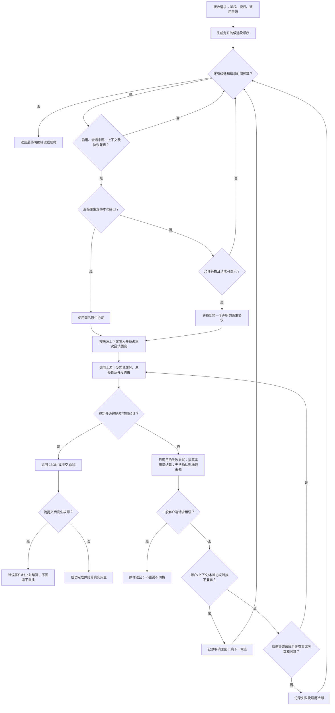

# 协议选路、桥接与回退合同

本说明对应实际网关实现和本地真实 HTTP 回归。这里的“消费端支持两种协议”不意味着网关自动替客户端改选接口：每个请求由调用路径 `/v1/chat/completions` 或 `/v1/responses` 确定客户端协议。

## 同时支持 Chat 与 Responses 时发生什么

**优先使用当前连接的同名原生协议。** Chat 请求接入同时支持 Chat 与 Responses 的连接时，发往上游 Chat，响应仍为 Chat；不会先绕 Responses 再桥接回来。即便连接 `native` 配置中 Responses 排在 Chat 前面，这一规则仍成立。

只有连接不支持请求协议，而且管理员明确开启 `allow_conversion`，才选该连接声明列表的第一个原生协议进行桥接。关闭转换则跳过不兼容候选；如果没有其他可用候选，返回明确错误。协议选择发生在每个候选连接内，并非先对所有供应商做“原生优先”的全局排序。因此较前的可转换连接仍可能先于较后的原生连接被使用。这项混合来源排序结论来自 `gateway.rs` 的候选循环与逐候选协议选择代码核查；本次新增矩阵没有单独构造“前桥接来源、后原生来源”的双来源集成场景。

协议声明是来源配置，不是一次请求中对多个路径轮询试错。声明同时支持两者却在 Chat 返回 404 时，网关按该次客户端错误返回，不自动改发 Responses；应修正来源能力配置或明确配置其他来源，避免重复调用和会话语义改变。

## 交叉回归矩阵

| 消费端能力 | 本次请求 | 上游原生能力 | 实际上游请求 | 下游收到 |
|---|---|---|---|---|
| 仅 Chat | Chat | 仅 Chat | Chat 原生 | Chat |
| 仅 Chat | Chat | Chat + Responses | Chat 原生 | Chat |
| Chat + Responses | Chat | 仅 Chat | Chat 原生 | Chat |
| Chat + Responses | Responses | 仅 Chat | 开启转换后 Responses→Chat | Chat 响应桥接为 Responses |
| Chat + Responses | Chat | Chat + Responses | Chat 原生 | Chat |
| Chat + Responses | Responses | Chat + Responses | Responses 原生 | Responses |
| 仅 Chat | Chat | 仅 Responses | 开启转换后 Chat→Responses | Responses 响应桥接为 Chat |
| 任意 | 上游未声明的协议 | 不兼容且关闭转换 | 不调用该上游 | 尝试其他候选或错误 |

以上成功路径均同时覆盖非流式 JSON 与 SSE 流式。测试以源服务器实际接收路径、请求字段、调用次数和客户端结果断言；不以 `select()` 的返回值替代网关验收。

## Responses 独有字段如何处理

同协议请求保留原生字段；网关仍执行鉴权、额度、用量解析、上下文与原生会话安全校验，不承诺忽略任意非法协议形状。原生 Responses 的 reasoning、summary、store 等不会因为另一条可用 Chat 接口而被删去；返回的 encrypted reasoning 保持原生结构。当前计量入口对 hosted/未知工具类型即使走原生也显式拒绝（HTTP 400，要求独立计量），不能把“同协议透传”理解为已支持所有上游收费能力。

跨协议使用显式白名单，**绝不把不认识的字段序列化后塞进用户消息**。无法无损表达的语义会拒绝该候选；尚未发出下游流时可继续其他兼容候选。

| 内容 | Chat↔Responses 桥接处理 |
|---|---|
| 文本和 system/developer/user/assistant | 转换成目标协议的消息结构；Responses `instructions` 映射 system |
| function 调用及 tool 结果 | 转换调用 ID、名称、参数、结果结构 |
| 输出上限 | 在目标接口对应字段间映射；冲突或非法值拒绝 |
| reasoning_effort / reasoning.effort | 映射原生 effort；具体档位由连接元数据校验，不按模型名字猜测 |
| service_tier | 保留原生值；不保证上游实际提供优先服务 |
| provider 原始 reasoning_text | 仅受限且可精确表示的形状转换；回放至 Chat 还须显式声明 chat_reasoning_replay |
| previous_response_id、opaque/encrypted reasoning 历史、hosted tools | 拒绝跨协议；要求原生协议 |
| active summary、`store:true`、图像转换、未知请求字段 | 拒绝跨协议 |
| 空/关闭 reasoning、空 include、`store:false` | 有限规范化，不能据此承诺返回 opaque reasoning |
| client_metadata / prompt_cache_key | 仅已校验的 CLI 追踪/缓存提示可省略，写 normalization note；不塞入消息，不记录原值 |
| 已知 OpenAI moderation telemetry | 受限规范化；不把安全控制字段或未知元数据当成普通提示省略 |

返回桥接也校验结构：无法表达的输出不会悄悄丢弃。流式开始前发现转换不兼容可换候选；已向客户端提交的流中途才出现不兼容内容，发错误事件并终止，不重播请求、不制造 completed 成功事件。原生 opaque 回放还受源连接/凭证/绑定代次校验约束，不能借“fallback”迁移供应商会话。

## 回退链与重试

同一逻辑模型的候选首先受用户/VKey 权限、模型和服务商启用状态、模型路由候选列表及顺序约束；会话固定来源、故障状态、上下文和并发限制继续适用。未填写路由列表时沿用模型来源顺序；填写列表会限制为列表中仍有效的来源，而非在失败后无限扩展到其他供应商。自动选模与某一模型的来源回退是两层决策。

普通 400/404/422 等错误不重试、不切换；明确上下文不足、已识别额度/认证故障有专门分类。网络错误、5xx、429、401/403 等按渠道/账户故障处理。每候选尝试次数受 `1 + retry_times` 与渠道冷却阈值共同限制；慢失败、预算不足不反复等满超时。收到 Retry-After 会影响等待和冷却。流式使用 attempt_timeout，非流式使用 nonstream_timeout；流提交前还受 request_budget 总预算约束，提交后是流读取闲置超时，不对已输出结果自动重放。

协议准备与可表示性判断先于该来源尝试的货币额度预占；上下文准入、凭证状态与预占仍以实际来源和本次尝试为准。未发起上游调用的本地拒绝不能被误算为已产生供应商费用。本地格式转换失败不会被算成该供应商原生协议不可用；已实际调用的失败尝试在重试或切换前按已获真实用量结算，用量无法确认时保留未知状态与独立账本记录，不能以重试抹账。

## 自定义探针：现状与待实现合同

当前后台探针支持启用/关闭、间隔、尝试超时和根据声明选择原生接口；成功响应还会经过有大小限制的 JSON/协议结构校验，但不验证自定义文本断言。探针正文固定为最小 ping（生成接口输出上限 1）、向量 x、rerank 的固定小样本。**尚不支持自定义正文和内容断言。** OAuth、独立搜索/抓取付费工具不会由此后台入口自动探测；应使用经过鉴权与计量的诊断执行器。

建议新增页面表单与类型化存储，而不是让用户手写 JSON：

- 范围：单来源+单逻辑模型；选择原生协议，不允许任意 URL/HTTP 方法/自带密钥绕开渠道配置。
- 内容：文本提示、可选系统提示、输入文档/查询（向量或 rerank 专用）、输出上限；保留默认极小探针供一键恢复。
- 成功条件：HTTP/协议有效、非空输出、可选“包含指定文本”或正则断言（限制模式长度与执行复杂度），区分连通成功与内容验收失败。
- 运行方式：手动“运行一次”与定时分别配置；显示模型、来源、预计上限和可能费用；固定并发 1，配置间隔、超时和每日用量上限。
- 执行：复用现有鉴权/凭证解密/协议/计量/取消执行器；不把 OAuth 或付费工具偷偷改成免费后台路径。记录探针类型及 request_id，费用与正常对话可区分；失败也保留实际已发生用量。
- 影响：内容断言失败默认只告警；是否影响该模型来源健康需明确开关。错误提示截断并去敏；禁止把 prompt、凭证、完整输出写入默认日志。

这部分是明确的后续实现合同，不表示自定义探针功能已经交付。

## 验证入口与证据边界

新增 `crates/server/tests/protocol_selection_matrix.rs` 覆盖路径/请求/返回协议矩阵；既有 `protocol_conversion_faults` 覆盖流提交前 fallback、提交后不重播、原生源不因桥接不兼容被冷却以及失败尝试计量；`protocol_safety`、`protocol_routes` 覆盖 native opaque 来源固定和回放边界。

测试只使用本机模拟上游，没有真实供应商费用；证明网关协议合同，不替代各供应商、订阅账号、长上下文、多模态和付费能力的逐项实测。
