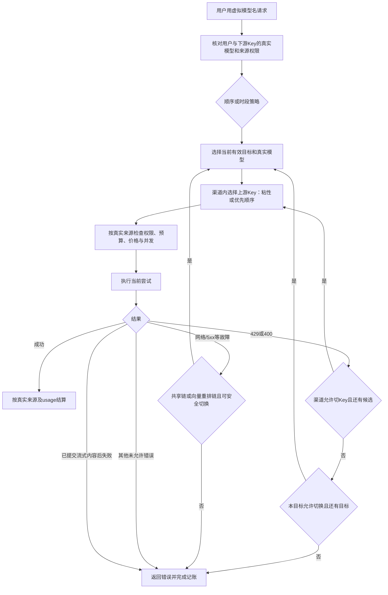

# 渠道 Key 池与用户私有调用策略

在线渠道对应供应方及一个完整 API URL（保留路径，如 `/v1`）；本地渠道可包含多个地址、每个地址独立配置模型和凭据。在线渠道可配置多个上游 API Key 或已授权、协议可用于推理的 OAuth 账号，本地渠道支持 API Key 或免密凭据。一个 Key 可以启用多个模型，模型保留标准名称及可选上游映射；推理档位使用模型原生参数。原来源 ID 继续用于授权、定价、账单和原生会话追踪，迁移不会重写这些身份。

## 新增与选择认证线路

从“供应商与接入 → 新建渠道”进入家族卡片、认证、模型与参数的完整流程。家族用于整理接入；同一家族的API线路与订阅OAuth线路可能使用不同地址、协议、目录及账号权益，不能把它们放在同一份能力声明中。已有渠道从“管理上游Key”增加凭据，从“选择模型”维护各凭据的模型；不要为了增加一把Key重建旧渠道或改写来源身份。具体步骤见[渠道接入](provider-channels.md#从新建渠道开始)。

OAuth支持范围和账号目录约束见[账号授权来源](oauth-providers.md)。OpenAI沿用浏览器PKCE；Kimi、MiniMax中国/Global、Copilot可发起设备授权。模型家族选择本身不授予订阅权限，OAuth token不由用户作为API Key填写。

## 三层策略：账号、节点、虚拟目标

渠道的 **逐个切换** 按 Key 优先顺序选择可用凭据；**并发分配** 将不同用户分散到可用 Key，同一用户的多个下游 API Key 共享粘性。并发分配不会同时发送多个相同推理请求。渠道 Key 的 429 切换默认开启，400 默认关闭；400 可能是请求参数错误，启用后只影响此请求的候选顺序，不将全部 400 作为全局坏 Key。

三层解决的问题不同，不能用其中一个开关代替另外两个：

| 层次 | 配置位置 | 分配单位与顺序 | 适用场景 |
| --- | --- | --- | --- |
| 上游 Key 池 | 供应商与接入 → 管理上游 Key | 逐个切换按优先级；并发分配按用户粘性选择 Key | 多账号额度分摊，同一用户保持账号稳定 |
| 本地节点轮询 | 模型路由的 `local_strategy` | `round_robin` 按请求轮转本地 Embeddings/Rerank 节点起点 | 同模型部署在多张 GPU/多个服务地址 |
| 虚拟模型调用链 | 用户调用策略或管理员共享虚拟模型 | 按目标顺序，或按当前时段选择目标链 | 云端优先、本地备用；工作日和夜间使用不同目标 |

普通标准模型还保留自身的来源路由与健康状态规则。虚拟链不会按运行评分重排管理员或用户指定的目标；每个目标内部仍使用该供应方的 Key 策略，本地节点可再使用轮询。因此“云端主目标 + 本地备用目标内两台 GPU 轮询”可以组合配置。

配置时先为各渠道/地址准备凭据与模型映射，再设置 Key 策略或本地节点轮询，最后创建虚拟入口并授权。用虚拟入口名字发起实际请求，在请求流水查看真实来源和尝试顺序；兼容诊断是额外的排错操作，无需先运行才能使用。

用户在“调用策略”页创建自己的虚拟模型名，选择供应方和真实模型，按第 1、2、3、4 步设定顺序。每一步单独决定收到 429/400 后是否继续下一个目标。渠道内先处理 Key 候选，再决定是否跨目标。私有 Chat/Responses/Messages 链只在目标允许的 400/429 条件下继续下一目标；网络/5xx 本身不会使它自动跨目标。私有 Embeddings/Rerank 链以及管理员共享链允许网络、超时、来源故障继续下一目标；400/429 仍必须满足对应显式开关。原生来源固定和流式内容已提交的限制优先，不能靠回退重放。

原生同协议响应保留上游原字段（包括上游自报的`model`），不会为虚拟名字改写响应。请求流水保存入站虚拟名，每笔尝试/账本保存真实目标、来源和价格；跨协议转换按已有保真合同执行。

每次新尝试都会复核用户、Key、目标授权、配置版本及当前时段；权限撤销或策略变化不会继续使用旧快照。已提交的流不会重放。原生 opaque 会话固定的真实来源优先于普通 Key 粘性，无法安全迁移时明确拒绝，不把原生状态发给另一账号。

## 时段与额度

时段支持北京时间和 UTC，按周一至周日选择，开始时间包含、结束时间不包含，跨午夜在编辑器拆分为两段；直接提交 API 时必须分别提交午夜前后的区间。每个时段选择目标步骤；无时段命中可设默认顺序，也可明确拒绝。正在进行的推理不会因为到点而中断，后续尝试重新检查时段。

虚拟模型名属于用户，不能引用另一个虚拟模型、`auto` 或已有标准模型名；不会扩大真实模型或来源权限。下游 Key 仍按真实目标受限。每次尝试按真实来源及真实模型定价，不能利用别名绕过预算或将不同上游费用混成一个价格。向量与重排的多目标链保存不访问上游，数值及输出兼容检查只用于用户主动排错；未验证、失败或过期不影响保存、正常调用和按配置回退。生产不自动运行兼容探测。对于向量/重排，连接、超时、5xx和结构不合格的成功响应按调用策略切换；400/429仍按目标开关。详见[兼容检查与输入范围](vector-fallback.md)。

## 旧配置与安全操作

旧服务商下不同 URL 或认证适配语义会拆成独立渠道；同一 URL 下的多个模型不会因此拆渠道。旧未分组来源归入明确的已导入入口，管理员可修改显示名。相同 OAuth 账号的多个模型部署共享一个凭据；API Key 的归一还会检查实际认证头，不凭名称合并。

Key 轮换、停用与优先顺序在渠道内操作。已有 API Key 默认掩码，管理员可显式“显示原 Key”或“复制原 Key”，页面退出编辑时清除显示内容；编辑留空保留密钥。OAuth 不暴露令牌。停用保留配置，可再次启用。渠道删除会在同一事务内清理所属 Key、接入映射及可变授权/路由引用，保留请求与财务历史；运行请求或未结算项存在时须等待，不通过删除历史来满足条件。见[删除合同](provider-channels.md#渠道界面与删除边界)。模型开关仅控制该渠道内模型，停用全部可用 Key 后模型不能继续作为可用目标。技术配置入口名为“诊断与分组”；涉及凭据和 URL 的变更通过渠道与 Key 管理。

本功能尚不等于月度套餐、按原始 Token 的额度或全品牌订阅支持。[自定义探针](custom-probes.md)已单独实现。这些工作见[需求完成度](requirements-status.md)。本地模拟通过也不代表外部付费来源真实可用。

## 本地供应方的多个服务地址

创建或编辑渠道时，服务类型选择“本地服务：多个 API 地址”。在“管理上游 Key”中为每个地址添加备注、API URL、API Key 或免密凭据及明确的模型名。例如同一供应方可配置 `http://192.168.1.10:8001/v1` 的聊天模型和 `http://192.168.1.10:8002/v1` 的向量模型。不会按 IP 自动合并，也不会把一个端口的模型和协议复制到另一个端口。

本地入口编辑 URL 只影响该入口；普通在线渠道仍在渠道设置中统一修改地址。不同端口使用相同密钥也保持独立凭据与轮换。含多个地址的本地渠道不能直接切回单地址模式。本地模式支持 API Key 或免密，不承接 OAuth 或独立搜索工具适配器。schema 37 为原渠道默认保留单地址模式。

模型详情按 Key 备注和服务地址展示状态与推理设置，内部来源身份用于授权和账单追溯，主操作列表不以编号命名。启停状态与操作按钮分开。推理档位未声明时保持默认，客户端明确指定的原生参数优先。

## 从已有 Key 选择上游模型

“管理上游 Key”打开弹窗并先列出已配置凭据，提供独立“编辑 Key”“选择模型”和启停操作。原 API Key 默认掩码，可由管理员显式查看/复制；编辑留空继续使用原值。选择“添加上游 Key”才打开新增表单。已停用渠道默认收起，可勾选“显示已停用渠道”查找。

在“选择模型”中点击上游模型名称输入框，自动使用该 Key 和对应服务地址读取目录。可搜索并多选，每选一项生成一组上游模型名与本地映射名，也可手工输入；失败可重新读取目录。普通API目录不可用时可手工配置；不会借用另一把Key的认证头。新OAuth凭据先完成授权并保存绑定：OpenAI、Kimi、Copilot按所属账号目录与协议校验，不能用手填模型绕过；MiniMax使用标记为`provider_public`的官方公共快照，不表示当前账号已获权益。目录检查不发送模型推理；账号目录可能更新缓存或正常刷新令牌。首次绑定还须提供经核实的输入/输出边界，完整流程见[OAuth文档](oauth-providers.md)。

例如上游模型名为 `vendor/chat-large`，本地映射名填写 `my-chat`，客户端便调用 `my-chat`；本地映射名留空时客户端直接调用 `vendor/chat-large`。已有映射名固定显示，保留原授权和历史；需要新名字时另加映射，再按需停用原映射。普通 API 的字段仍为 `model`（本地名）及可选 `upstream`（上游名），保持兼容。

本地现存配置的归并须明确供应方和原来源，先冷备、核对 Key/模型/权限/价格/历史/粘性后事务迁移，最后验证启动幂等；不可通过重建来源或Key来达到看似归并的效果。

## 本地向量节点等权轮询

模型路由可配置 `local_strategy: "round_robin"`，在本地Embeddings/Rerank获授权来源间按请求轮转起点，并沿用故障切换；`ordered`或省略继承已有Key策略。它与在线Key按用户粘性不同，不影响OAuth/native来源固定。游标按调用入口、owner、provider及目标模型隔离，进程重启后重置；不是分布式加权或等GPU利用率承诺。来源身份变化后可按需重新运行兼容诊断，旧诊断记录不影响正常调用。详见[本地节点合同](maintenance/local-vector-balancing.md)。
