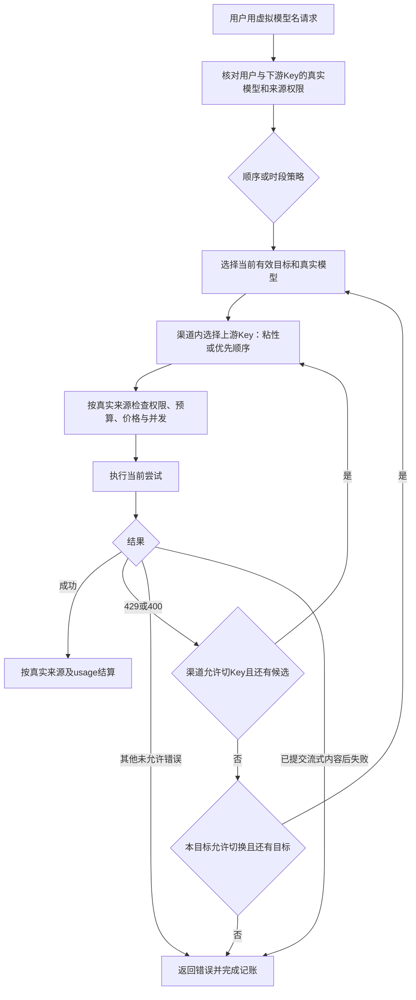

# 渠道 Key 池与用户私有调用策略

在线渠道对应供应方及一个完整 API URL（保留路径，如 `/v1`）；本地渠道可包含多个地址、每个地址独立配置模型和凭据。在线渠道可配置多个上游 API Key 或已授权 GPT OAuth 账号，本地渠道支持 API Key 或免密凭据。一个 Key 可以启用多个模型，模型保留标准名称及可选上游映射；推理档位使用模型原生参数。原来源 ID 继续用于授权、定价、账单和原生会话追踪，迁移不会重写这些身份。

## 两层切换

渠道的 **逐个切换** 按 Key 优先顺序选择可用凭据；**并发分配** 将不同用户分散到可用 Key，同一用户的多个下游 API Key 共享粘性。并发分配不会同时发送多个相同推理请求。渠道 Key 的 429 切换默认开启，400 默认关闭；400 可能是请求参数错误，启用后只影响此请求的候选顺序，不将全部 400 作为全局坏 Key。

用户在“调用策略”页创建自己的虚拟模型名，选择供应方和真实模型，按第 1、2、3、4 步设定顺序。每一步单独决定收到 429/400 后是否继续下一个目标。渠道内先尝试可用 Key，允许时才继续用户的下一目标；未声明的网络/5xx错误停止私有链。标准模型原有全局路由保持自身规则。

原生同协议响应保留上游原字段（包括上游自报的`model`），不会为虚拟名字改写响应。请求流水保存入站虚拟名，每笔尝试/账本保存真实目标、来源和价格；跨协议转换按已有保真合同执行。

每次新尝试都会复核用户、Key、目标授权、配置版本及当前时段；权限撤销或策略变化不会继续使用旧快照。已提交的流不会重放。原生 opaque 会话固定的真实来源优先于普通 Key 粘性，无法安全迁移时明确拒绝，不把原生状态发给另一账号。

## 时段与额度

时段支持北京时间和 UTC，按周一至周日选择，开始时间包含、结束时间不包含，跨午夜自动拆分。每个时段选择目标步骤；无时段命中可设默认顺序，也可明确拒绝。正在进行的推理不会因为到点而中断，后续尝试重新检查时段。

虚拟模型名属于用户，不能引用另一个虚拟模型、`auto` 或已有标准模型名；不会扩大真实模型或来源权限。下游 Key 仍按真实目标受限。每次尝试按真实来源及真实模型定价，不能利用别名绕过预算或将不同上游费用混成一个价格。向量模型目前只允许单一目标；多目标向量回退须先实现并验证维度合同。

## 旧配置与安全操作

旧服务商下不同 URL 或认证适配语义会拆成独立渠道；同一 URL 下的多个模型不会因此拆渠道。旧未分组来源归入明确的已导入入口，管理员可修改显示名。相同 OAuth 账号的多个模型部署共享一个凭据；API Key 的归一还会检查实际认证头，不凭名称合并。

Key 轮换、停用与优先顺序在渠道内操作，明文密钥不回显。停用保留历史，可再次启用；有来源、会话、授权、虚拟路由或财务历史依赖的渠道不能硬删除，使用渠道停用。模型开关仅控制该渠道内模型，停用全部可用 Key 后模型不能继续被作为可用目标。旧技术配置收在高级诊断中，涉及凭据和 URL 的变更必须走渠道与 Key 池入口。

本功能尚不等于月度套餐、按原始 Token 的额度、自定义探针或全品牌订阅支持。这些工作见[需求完成度](requirements-status.md)。本地模拟通过也不代表外部付费来源真实可用。

## 本地供应方的多个服务地址

创建或编辑渠道时，服务类型选择“本地服务：多个 API 地址”。在“管理上游 Key”中为每个地址添加备注、API URL、API Key 或免密凭据及明确的模型名。例如同一供应方可配置 `http://192.168.1.10:8001/v1` 的聊天模型和 `http://192.168.1.10:8002/v1` 的向量模型。不会按 IP 自动合并，也不会把一个端口的模型和协议复制到另一个端口。

本地入口编辑 URL 只影响该入口；普通在线渠道仍在渠道设置中统一修改地址。不同端口使用相同密钥也保持独立凭据与轮换。含多个地址的本地渠道不能直接切回单地址模式。本地模式支持 API Key 或免密，不承接 OAuth 或独立搜索工具适配器。schema 37 为原渠道默认保留单地址模式。

模型详情按 Key 备注和服务地址展示状态与推理设置，内部来源编号保留在高级诊断供授权和账单追溯。启停状态与操作按钮分开。推理档位未声明时保持默认，客户端明确指定的原生参数优先。

## 从已有 Key 选择上游模型

“管理上游 Key”先列出已配置的凭据。密钥不回显，编辑时留空继续使用原值；选择“添加上游 Key”才打开新增表单。已停用渠道默认收起，可勾选“显示已停用渠道”查找。

在 Key 编辑中点击“探测此 Key 的上游模型”，使用该 Key 和对应服务地址读取目录。可以搜索、多选并添加，或直接在“上游模型名”输入框下拉选择、手工输入。目录不可用时仍可手工配置；不会借用另一把 Key 的认证头。新 GPT OAuth 凭据先保存绑定，再编辑读取对应账号官方目录。探测只取目录，不发送模型推理；官方账号目录可能更新缓存或正常刷新令牌。

例如上游模型名为 `vendor/chat-large`，本地映射名填写 `my-chat`，客户端便调用 `my-chat`；本地映射名留空时客户端直接调用 `vendor/chat-large`。已有映射名固定显示，保留原授权和历史；需要新名字时另加映射，再按需停用原映射。普通 API 的字段仍为 `model`（本地名）及可选 `upstream`（上游名），保持兼容。

本地现存配置的归并须明确供应方和原来源，先冷备、核对 Key/模型/权限/价格/历史/粘性后事务迁移，最后验证启动幂等；不可通过重建来源或Key来达到看似归并的效果。
